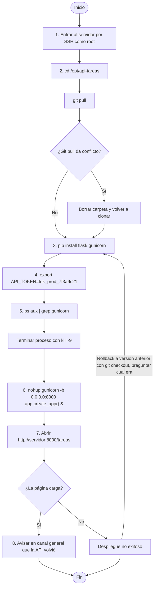
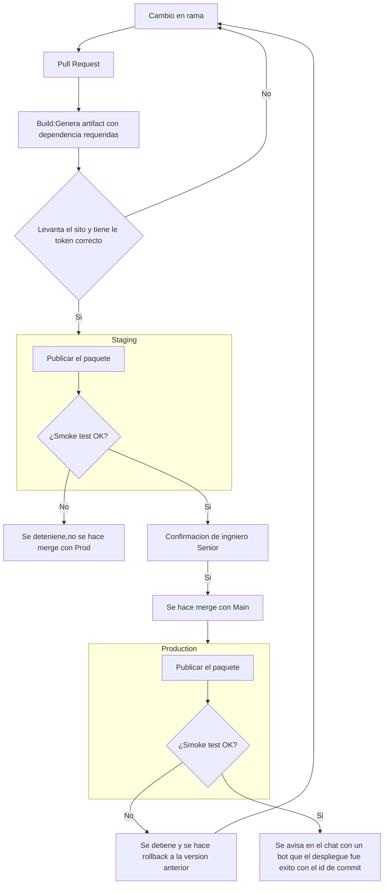

# Mapa de estrategia CI/CD - API de tareas

> Autor o autora: Josué Alvarado Salazar 
> Punto de partida: `docs/DESPLIEGUE_MANUAL.md`, el proceso manual que el pipeline va a reemplazar.
> Cómo se ve un mapa terminado: `docs/ejemplo-mapa-cicd-sitio.md` (otro caso, mismo método).
> Sintaxis de los diagramas: la Guía rápida de Mermaid (Moodle, material de apoyo).

## 1. Flujo de commit a producción

Reemplazar este esqueleto por el flujo completo: etapas, ambientes y los puntos donde decide una
persona. GitHub y la vista previa de VS Code (`Ctrl+Shift+V`) muestran el diagrama. Si queda muy
ancho, cambiar `LR` por `TD`.

Procedimiento Original Graficados, se utlizo chat GPT para su creacion

Cambio en una rama
Pull request 
Build: Generar el sitio 
Sino  tiene el token correcto, pasa sino vuelve al primer punto 
Se para al area de staging, se publica el paquete, y se corre un smoke test, si este falla  , El commit a prod no sucede, Si si lo pasa se hace merge con main
Se oublica en produccion, se repite proceso del spoke test si este falla se hace rollback automatico a la misma version 

## 2. Ambientes

| Ambiente   | Para qué sirve                          | Cómo llega un cambio                                            | Quién decide que llegue |
| ---------- | --------------------------------------- | --------------------------------------------------------------- | ----------------------- |
| Local      | Desarrollo  y pruebas locales           | Por el cambio por el desarrollador                              | El pipeline             |
| Staging    | Verificar el codigo corra sin problemas | Automático, luego de validaciones basicas                       | El pipeline             |
| Produccion | Para correr el sitio publico            | Aprobacion de un senior luego de que staging no tenga problemas | Senior                  |

## 3. Riesgos del proceso manual y controles

Un renglón por riesgo. La columna "Paso" cita el paso de `DESPLIEGUE_MANUAL.md`.

| Paso                 | Riesgo                                                                   | Qué puede pasar                                                                                                                            | Control del pipeline que lo atiende                                                   | Etapa del flujo                                                            |
| -------------------- | ------------------------------------------------------------------------ | ------------------------------------------------------------------------------------------------------------------------------------------ | ------------------------------------------------------------------------------------- | -------------------------------------------------------------------------- |
| -3                   | Consistencia, velocidad de respuesta                                     | Depende que alguien vea un mensaje, y que responda en un tiempo razonable                                                                  | El pipeline detecta cambios en branches y requiere validation manual                  | Build                                                                      |
| -2                   | Comunicación, disponibilidad                                             | Si alguien no ve el chat, no va a estar enterado que el servicio estar caido                                                               | Con un ambiente de staging no hay necesidad de apagar el servicio                     | Pruebas y Validaciones                                                     |
| -1                   | Seguridad, filtraciones, falta de trazabilidad                           | Se filtre la clave del servidor                                                                                                            | Credenciales guardadas como secreto del ambiente; solo el pipeline las usa            | Despliegue                                                                 |
| 1                    | Seguridad, elimination de archivos                                       | Acceso root permite mas acciones de las necesarias en el servido y puede llevara a filtraciones o modification de los archivos incorrectos | Se elimina el acceso manual al root y se le otorgan al pipeline solo los necesarios   | Build                                                                      |
| 2                    | Elimination de archivos, acceder a la carpeta manualmeten                | Puede llevar a errores por confusiones al ser manualmente                                                                                  | Se sube el paquete completo y se cambia de versión de una sola vez                    | Despliegue                                                                 |
| 3                    | Errores al correr comandos manualmente, no se fija versiones especificas | Se instalan dependencias incorrectas, o desactualizadas                                                                                    | Verificador de enlaces en el pull request y smoke test después de publicar en staging | Despliegue                                                                 |
| 4                    | Token expuesto, seguridad, accesos                                       | Causa un typo, no se escribe bien el token, se esta guardando como texto plano                                                             | Token guardadas como secreto del ambiente; solo el pipeline las usa                   | Despliegue                                                                 |
| 5                    | Se detenga el proceso incorrecto                                         | Causar problemas de disponibilidad para otros servicio, o problemas al hora de levantar la nueva version                                   | El pipeline se encarga de detener y iniciar el sitio                                  | Despliegue                                                                 |
| 6                    | El proceso es manual                                                     | Se puede fallar al levantar por algún typo                                                                                                 | El pipeline se encarga de detener y iniciar el sitio                                  | Artefacto                                                                  |
| 7                    | Falta de pruebas suficientes                                             | Requiere validation manual y solamente visual del sistema                                                                                  | Verificador de enlaces en el pull request y smoke test después de publicar            | Pruebas y Validaciones                                                     |
| 8                    | Podría omitirse por olvido, es manual                                    | Se podría olvidar y el equipo no estaría al tanto de los cambios en prod                                                                   |                                                                                       | Pruebas y Validaciones                                                     |
| 9(Si algo sale mal ) | No saber cual era la version anterior                                    | Puede causar volver a la version incorrecta                                                                                                | el pipeline hace rollback automáticamente                                             | Verificador de enlaces en el pull request y smoke test después de publicar |

## 4. Criterios de éxito

Qué tiene que ser verdad para decir que un despliegue salió bien, de forma que una máquina lo
pueda comprobar.

- Que le sitio levante sin problemas
- Que los path respondan correctamente con el codigo correcto 

## 5. Decisiones y preguntas abiertas

-Como notifica el developer de cambios ?

Uso de IA: Se uso para el primer grafico 